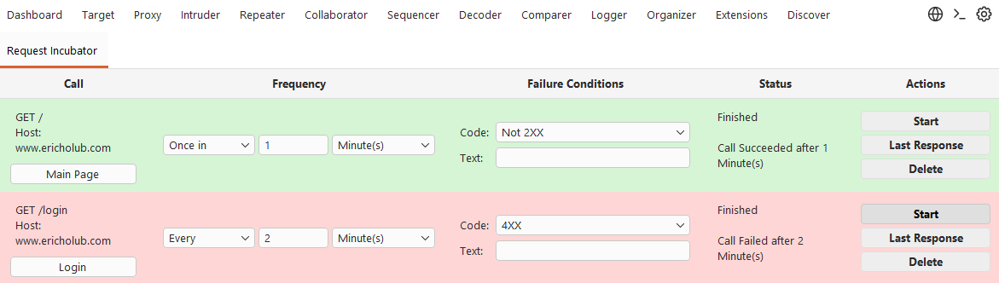

# Request Incubator

**Keep HTTP requests alive. Stop when something changes.**

Request Incubator is a Burp Suite extension that automatically repeats HTTP requests on a configurable schedule until a user-defined failure condition is met.

Incubate requests from anywhere in Burp Suite with a simple right-click action, configure when requests should be sent and what conditions should stop execution, and let Request Incubator handle the rest.

Whether you're testing session expiration, rate limiting, token validity, or application state changes, Request Incubator makes long-running, repetitive HTTP testing easy.



## ✨ Features

- **Incubate Requests Anywhere** — Right-click any request in Burp Suite and select `Extensions → Request Incubator → Incubate Request`.
- **Flexible Scheduling** — Send requests once after a specified delay or repeat them at a regular interval.
- **Multiple Time Units** — Configure intervals in seconds, minutes, or hours.
- **Customizable Failure Conditions** — Stop execution based on HTTP status-code categories, specific response behavior, or text found in the response body.
- **Live Response Monitoring** — Inspect the latest response to see what happened when a request was sent.
- **Automated Execution** — Let requests run in the background until a failure condition is triggered or you manually stop the process.
- **Native Burp Workflow** — Configure and monitor incubated requests directly from the dedicated Request Incubator tab.

## 🚀 How It Works

1. **Select a request.** Find any HTTP request in Burp Suite.
2. **Incubate it.** Right-click the request and select `Extensions → Request Incubator → Incubate Request`.
3. **Configure the schedule.** Choose whether to send the request once after a delay or repeatedly at a specified interval.
4. **Define a failure condition.** Select an HTTP status-code category, a non-200 response, or custom text to detect in the response.
5. **Start incubation.** Request Incubator sends the request according to your schedule and evaluates each response.
6. **Wait for the trigger.** Execution automatically stops when the configured failure condition is met.

## ⏱️ Scheduling Options

Request Incubator supports two scheduling modes:

| Mode | Behavior | Example |
|---|---|---|
| **Once in N** | Send the request once after the specified delay. | Once in 5 minutes |
| **Every N** | Send the request repeatedly at the specified interval. | Every 30 seconds |

Choose an interval in seconds, minutes, or hours to suit your testing scenario.

## 🛑 Failure Conditions

Choose the condition that determines when an incubated request should stop repeating.

| Condition | Behavior |
|---|---|
| **3XX** | Stop when the response has a 3XX redirection status code. |
| **4XX** | Stop when the response has a 4XX client error status code. |
| **5XX** | Stop when the response has a 5XX server error status code. |
| **Not 200** | Stop when the response status code is anything other than `200 OK`. |
| **Response Text** | Stop when the response contains user-defined text. |

These conditions let you monitor both HTTP-level failures and application-specific changes that may only be visible in the response content.

## 🧪 Example Use Cases

### Session Expiration

Incubate an authenticated request and repeat it every few minutes. Set the failure condition to `401 Unauthorized` or `403 Forbidden` to detect when the session or authorization context stops working.

### Token and Credential Validity

Monitor an authenticated endpoint with a response-text condition. Stop incubation when a message such as `Invalid token` or `Session expired` appears in the response.

### Background Job Monitoring

Send a request periodically and stop when the application returns a non-200 response, indicating that the endpoint's expected behavior has changed.


## 🛠️ Installation

1. Clone or download this repository.
2. Build the extension with mvn.
```
mvn clean package
```
3. Open Burp Suite and navigate to **Extensions → Installed**.
4. Click **Add** and select the appropriate extension type.
5. Load the built extension.
6. Open the **Request Incubator** tab to configure and manage incubated requests.

Refer to the project's build files for specific build instructions.

## 🔐 Responsible Use

Request Incubator is intended for authorized security testing, debugging, and application behavior analysis.

Repeated requests can trigger rate limits, consume server resources, or modify application state. Take care when incubating requests that perform state-changing operations, and use reasonable intervals when testing production systems.

Only use this extension against systems you own or have explicit permission to test.


## 📄 License

See the repository's license file for terms of use and redistribution.
